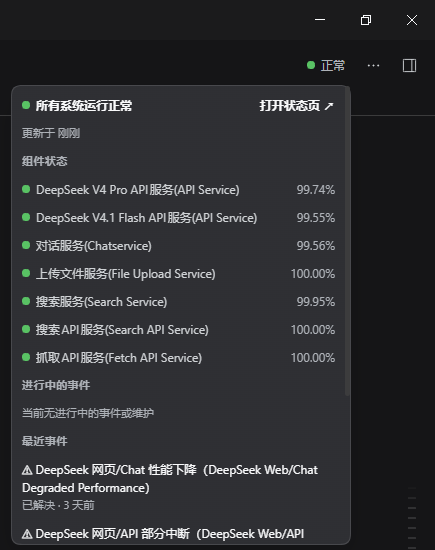
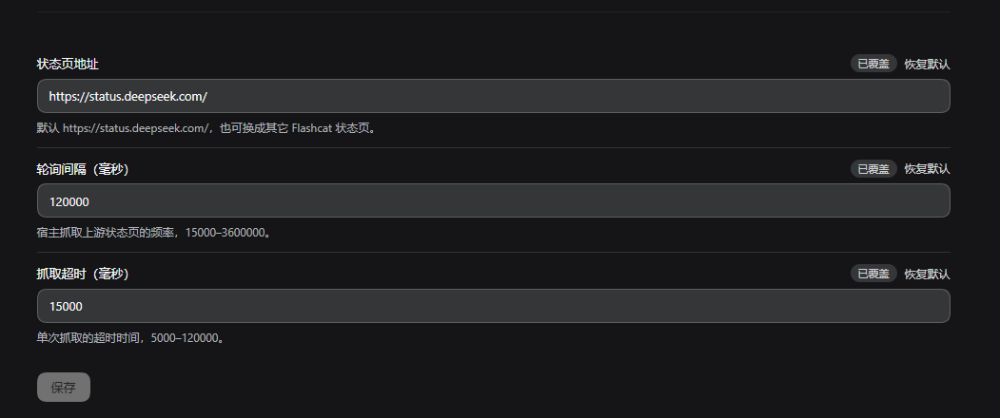

# dsh-deepseek-status（@mengls1620 维护版）

在 DeepSeek Harness（DSH）的 Web UI 会话头部实时显示 **DeepSeek 官方服务状态**（status.deepseek.com）：总体状态、各组件状态、进行中/最近事件、组件可用率。

A DSH plugin that shows the live DeepSeek official service status in the session header — overall status, per-component status, active/recent incidents, and uptime percentages.

[npm](https://www.npmjs.com/package/@mengls1620/dsh-deepseek-status) · [Issues](https://github.com/MengLs1620/dsh-deepseek-status/issues) · [CHANGELOG](https://github.com/MengLs1620/dsh-deepseek-status/blob/main/CHANGELOG.md) · [市场收录](https://github.com/awesome-dsh-plugin/awesome-dsh-plugin/pull/13103)





> **维护说明**：本仓库是 [`KekuKase/dsh-deepseek-status`](https://github.com/KekuKase/dsh-deepseek-status) 的维护 fork。**0.1.4 起由 [MengLs1620](https://github.com/MengLs1620) 接手代码维护**（跟随 DSH 新版本适配、修复问题）；**0.1.6 起以 `@mengls1620/dsh-deepseek-status` 独立发布并维护 npm 包**。旧包 `dsh-deepseek-status`（最新 0.1.3）已停止维护，在 DSH 0.2.x 上启动会报错。
>
> This is a maintained fork. Code maintenance by MengLs1620 since 0.1.4; independently published on npm as `@mengls1620/dsh-deepseek-status` since 0.1.6.

## 功能

- 状态点 + 颜色/文字：绿=全部正常 / 蓝=维护中 / 黄=性能下降 / 橙=部分故障 / 红=严重故障 / 灰=未知
- 点击展开面板：总体状态、最后更新时间、各组件状态、进行中事件/维护、最近事件、各组件可用率
- 上游故障时保留最后一次成功快照，并显示「更新于 X 分钟前」，不显示假「正常」
- 设置卡片可改状态页地址、轮询间隔、抓取超时；**保存后无需重启**

## 安装

**桌面端（推荐）**：侧栏 →「插件」→ 搜索/安装 `@mengls1620/dsh-deepseek-status`，装好后**完全退出并重开 DSH**（宿主代码不会热加载）。

**命令行 / Web 端**：

```sh
dsh plugin --profile web add @mengls1620/dsh-deepseek-status
```

`web` 换成你的 profile 名即可（桌面端通常是 `desktop`）。

> ⚠️ **从旧版迁移**：装过旧包 `dsh-deepseek-status`（作者 npm 下的 0.1.3，或旧 tarball）的，先卸载再装新包：
>
> ```sh
> dsh plugin --profile web remove dsh-deepseek-status
> ```
>
> 新旧两个包会注册同一个路由和同一个行 id，不能共存；设置项会按新包名重置一次。

也可以从源码构建（npm 尚未同步时）：

```sh
git clone https://github.com/MengLs1620/dsh-deepseek-status.git
cd dsh-deepseek-status
npm pack
dsh plugin --profile web add ./mengls1620-dsh-deepseek-status-0.1.9.tgz
```

## 配置

默认无需配置。三种覆盖方式（生效优先级从低到高）：profile 的 `cordis.patch.yml` → `$DSH_HOME/settings.yaml`（旧版兼容）→ 插件页设置卡片。

| 配置项 | 默认值 | 说明 |
|---|---|---|
| `statusUrl` | `https://status.deepseek.com/` | 状态页地址（可换其它 Flashcat 状态页） |
| `pollIntervalMs` | `60000` | 宿主轮询间隔（毫秒，15000–3600000） |
| `timeoutMs` | `15000` | 单次抓取超时（毫秒，5000–120000） |

设置卡片保存后**无需重启**：换状态页地址/超时立即重新抓取；改轮询间隔会重新挂定时器，通常一个周期内生效。实测 DSH 0.2.2-rc.3：轮询间隔从 120000 改成 20000 并保存后，宿主抓取间隔立即变为 20 秒。

实现细节（两段式设置、slot key、刷新加锁等）见 [DEVELOPMENT.md](https://github.com/MengLs1620/dsh-deepseek-status/blob/main/DEVELOPMENT.md)。

## 兼容性

| 插件版本 | DSH | 说明 |
|---|---|---|
| **0.1.9（当前）** | **0.2.x** | 链接跟随 `statusUrl`、刷新串行化、`configForms` 可选、配置变化精准处理、2 MiB 响应上限、CI 闸门加固 |
| 0.1.6–0.1.8 | 0.2.x | 维护 fork 的独立发布线（0.1.6 起改为 scoped npm 包名；0.1.8 增加插件图标） |
| 0.1.2–0.1.5 | 0.1.x / 0.2.x | 旧版本，详见 [CHANGELOG](https://github.com/MengLs1620/dsh-deepseek-status/blob/main/CHANGELOG.md) |

**验证环境**：Windows + DSH **0.2.2-rc.3**（`@deepseek-ai/schemastery` 3.19.0、cordis 4.1.0）；`npm test` **26 项通过**；0.1.9 上实测挂件/面板/设置卡片正常，改配置保存即时生效。0.1.x 未实测（0.1.9 起 `configForms` 为可选，理论上挂件仍可用，但未验证）。

## 安装后自检

1. 会话头部出现状态点（颜色为绿/蓝/黄等，而不是灰）；
2. 点击能展开面板，显示组件状态与更新时间；
3. 插件页能看到本插件的设置卡片；改一次轮询间隔并保存，面板「更新于」应在下个周期刷新。

有问题请开 [Issue](https://github.com/MengLs1620/dsh-deepseek-status/issues)。

## 数据与隐私

- 宿主直接请求你配置的 `statusUrl`（默认 `https://status.deepseek.com/`）；不收集数据、无遥测、不上报第三方；
- 只接受绝对 `http(s)` 地址；响应解压后最多读取 2 MiB（正常页面约 216 KiB），超过上限按失败处理并保留上次成功快照；
- 官方页由 Flashcat(FlashDuty) 托管，是 Next.js SSR 页面，状态数据内嵌在首页 HTML 的 flight 负载中；解析按字段名定位，失败时保留旧快照。

## 维护与贡献

- 维护者：[MengLs1620](https://github.com/MengLs1620)；跟随 DSH 新版本适配，问题/建议走 [Issues](https://github.com/MengLs1620/dsh-deepseek-status/issues)。
- 开发者：架构、测试、发布链路见 [DEVELOPMENT.md](https://github.com/MengLs1620/dsh-deepseek-status/blob/main/DEVELOPMENT.md)。
- 用 AI 助手安装/排障：步骤见 [AGENTS.md](https://github.com/MengLs1620/dsh-deepseek-status/blob/main/AGENTS.md)。

## 卸载

```sh
dsh plugin --profile web remove @mengls1620/dsh-deepseek-status
```

## License

[MIT](./LICENSE)
